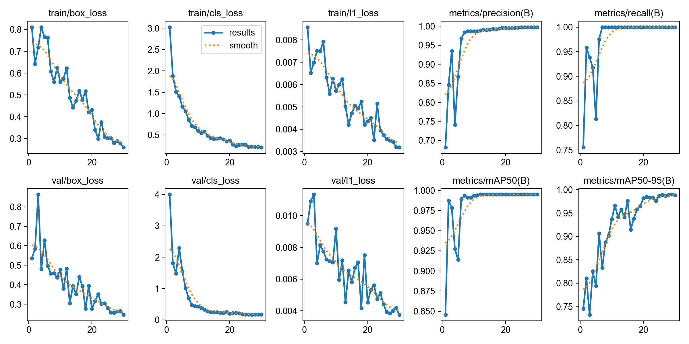
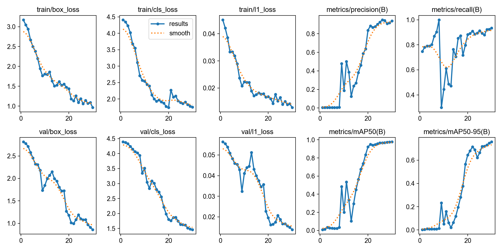
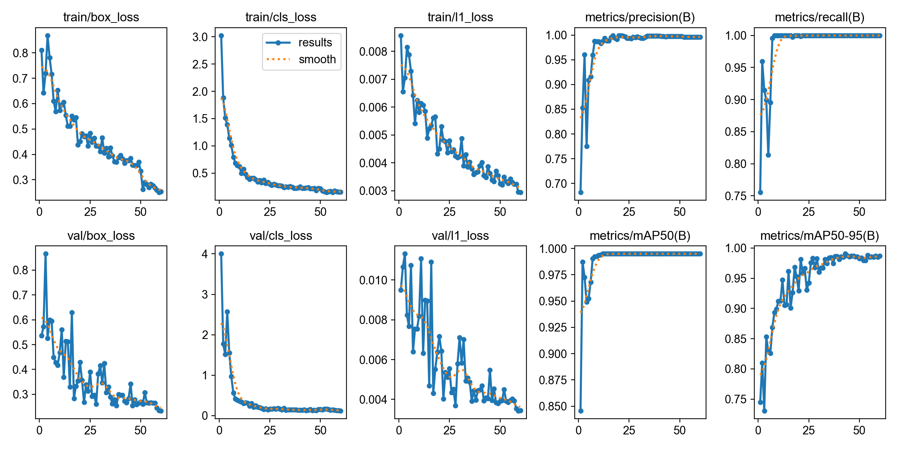

# PJ1 - Deteksi Objek YOLO (victim dan dummy)

Deteksi objek (bounding box) untuk dua kelas, **victim** dan **dummy**, memakai YOLO (Ultralytics).
Alur kerja dijalankan lokal di VS Code, menggantikan fungsi Roboflow untuk persiapan dan pembagian data.

## Dataset
- 222 gambar (frame dari beberapa video), dianotasi di Roboflow dan diekspor dalam format COCO ke `raw_data/`.
- Kelas: `0 = victim` (di JSON bernama `korban`), `1 = dummy`.
- Pembagian: 155 train, 44 val, 23 test (acak, seed 42).
- Kotak duplikat dibuang otomatis oleh skrip 00.

## Struktur
| File / folder | Fungsi |
|---|---|
| `raw_data/` | Data mentah hasil ekspor Roboflow (train, valid, test) |
| `00_ambil_subset_coco.py` | COCO (raw_data) menjadi `dataset_yolo/` (label YOLO) |
| `01_cek_anotasi.py` | Memeriksa label dan menggambar kotak untuk dicek visual |
| `02_yolo_ke_coco.py`, `03_coco_ke_yolo.py` | Konversi antar format YOLO dan COCO |
| `05_split_dataset_yolo.py` | Membagi dataset menjadi `dataset_v1/` dan membuat `data.yaml` |
| `06_latih_bandingkan.py` | Melatih dan membandingkan eksperimen E1, E2, E3 |
| `hasil_praktik/` | Grafik dan gambar prediksi tiap eksperimen |
| `hasil_praktik_4222411048.txt/.csv` | Ringkasan hasil |

`dataset_yolo/`, `dataset_v1/`, `runs/`, dan file `.pt` tidak diunggah; semuanya dibuat ulang oleh skrip.

## Cara menjalankan
```bash
pip install ultralytics opencv-python
python 00_ambil_subset_coco.py
python 01_cek_anotasi.py dataset_yolo
python 05_split_dataset_yolo.py
python 06_latih_bandingkan.py --nim 4222411048 --nama "Muhammad Rasyid Prasetyo" --device cpu
```
Pengaturan: model `yolo26n`, 30 epoch, imgsz 416, batch 16, dilatih di CPU (AMD Ryzen 5 PRO 5675U).

## Hasil eksperimen
| Eksperimen | Perubahan | mAP50 | mAP50-95 | Precision | Recall | Waktu latih (menit) |
|---|---|---|---|---|---|---|
| E1 pretrained | - | 0,995 | 0,990 | 0,997 | 1,000 | 18,2 |
| E2 scratch | tanpa bobot pralatih | 0,977 | 0,758 | 0,937 | 0,934 | 17,2 |
| E3 tuning | epochs=60 | 0,995 | 0,991 | 0,997 | 1,000 | 34,9 |

### Grafik pelatihan

**E1 - pretrained (30 epoch)**


**E2 - scratch (30 epoch)**


**E3 - tuning, epochs=60**


Dari grafik terlihat E1 dan E3 stabil dengan mAP mendekati 1,0 sejak awal, sedangkan E2 baru mulai belajar setelah sekitar epoch 8 dan mAP50-95-nya masih naik di epoch 30.

Model terpilih berdasarkan mAP50-95 pada data validasi: **E3**.
Hasil pada data test (sekali uji): mAP50 0,995 dan mAP50-95 0,986.

## Kesimpulan
- Transfer learning (E1) menaikkan mAP50-95 dari 0,758 (E2) menjadi 0,990 pada waktu latih yang sama.
- Menambah epoch dari 30 menjadi 60 (E3) hanya menaikkan mAP50-95 sebesar 0,001 dengan waktu latih hampir dua kali lipat.

## Keterbatasan
- Gambar berasal dari frame video yang berdekatan dan sangat mirip, sehingga pembagian acak dapat membuat data validasi dan test mirip dengan data latih. Nilai metrik yang sangat tinggi kemungkinan lebih optimistis daripada kondisi nyata.
- Set validasi (44 gambar) dan test (23 gambar) kecil, sehingga selisih kecil antar eksperimen belum tentu bermakna.
